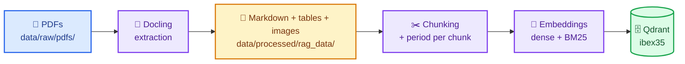
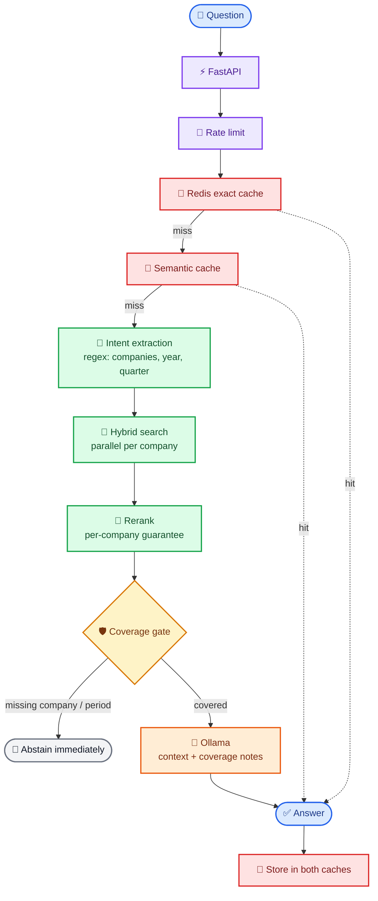

# IBEX35 RAG

Retrieval-Augmented Generation system for querying the financial reports of companies in Spain's IBEX35 index. It turns PDF reports into a hybrid (dense + BM25) Qdrant index, answers questions with a local LLM served by Ollama, and ships with a full observability stack (Prometheus, Grafana, Loki, Tempo, Alertmanager).

The RAG core runs fully locally and needs no external API keys. Only the agent mode (live market data through `yfinance`) and optional LangSmith tracing require outbound internet access.

> [!NOTE]
> **Yes, the stack is deliberately bigger than a single-user app needs.** Answering questions only takes five services: `api`, `ollama`, `qdrant`, `redis` and `frontend`. The other eleven (Prometheus, Grafana, Loki, Promtail, Tempo, OTel Collector, Alertmanager, node-exporter, cAdvisor, redis-exporter and redis-commander) are there to show how the system would be monitored and operated in production. The same goes for rate limiting, the semantic cache and online RAGAS evaluation. `make start` currently launches all sixteen.

## Table of contents

- [Features](#features)
- [Architecture at a glance](#architecture-at-a-glance)
- [Tech stack](#tech-stack)
- [Quickstart](#quickstart)
  - [Prerequisites](#prerequisites)
  - [1. Clone and configure](#1-clone-and-configure)
  - [2. Add your PDFs](#2-add-your-pdfs)
  - [3. Start the stack](#3-start-the-stack)
  - [4. Ask a question](#4-ask-a-question)
- [In detail](#in-detail)
  - [How a question is answered](#how-a-question-is-answered)
  - [Data ingestion](#data-ingestion)
  - [API reference](#api-reference)
  - [Chat frontend](#chat-frontend)
  - [Configuration](#configuration)
  - [Observability](#observability)
  - [Service URLs](#service-urls)
  - [Make targets](#make-targets)
  - [Local development (API outside Docker)](#local-development-api-outside-docker)
  - [Testing](#testing)
  - [Project structure](#project-structure)
  - [Covered companies](#covered-companies)
- [Troubleshooting](#troubleshooting)
- [Contributing](#contributing)
- [Documentation](#documentation)
- [License](#license)

## Features

- **Hybrid retrieval**: dense embeddings (`nomic-embed-text`) plus sparse BM25 in Qdrant, with parallel per-company search for multi-company questions.
- **Cross-encoder reranking** (`BAAI/bge-reranker-base`) with a minimum number of chunks guaranteed per requested company, so no company is crowded out in comparisons.
- **Pre-LLM coverage gate**: before generating, the engine checks that every requested company and period is actually covered by the retrieved context. If not, it abstains with an explicit explanation instead of letting the LLM guess.
- **Out-of-domain detection**: questions about non-IBEX35 companies (Tesla, Apple, ...) get an immediate abstention without touching the index.
- **Financial agent**: a LangGraph tool-calling agent with per-session memory that combines the report knowledge base with live market data (prices, history, comparisons).
- **Auto-routing**: `/ask` sends fundamentals questions to RAG and market/price questions to the agent, using keyword heuristics with an LLM fallback.
- **Two cache layers**: exact-match Redis cache and a semantic cache (Qdrant ANN over FastEmbed vectors).
- **Streaming**: Server-Sent Events endpoint for token-by-token answers.
- **Production concerns**: Redis sliding-window rate limiting, structured JSON logs, Prometheus metrics, OpenTelemetry traces, online RAG quality metrics (RAGAS + proxy metrics), Grafana dashboards and alert rules.

## Architecture at a glance

**Ingestion**



**Query**



See [docs/architecture.md](docs/architecture.md) for the component diagram and request lifecycle.

## Tech stack

| Component | Technology |
|---|---|
| LLM | Ollama (`qwen2.5:7b` by default) |
| Embeddings | Ollama (`nomic-embed-text:latest`) |
| PDF extraction | Docling (structured Markdown, tables, page images) |
| RAG / agent framework | LangChain + LangGraph |
| Vector store | Qdrant (dense cosine + sparse BM25) |
| Reranking | `BAAI/bge-reranker-base` cross-encoder (CUDA when available) |
| API | FastAPI + Pydantic v2 |
| Frontend | Chainlit |
| Cache and rate limiting | Redis |
| Metrics | Prometheus (+ node-exporter, cAdvisor, redis-exporter) |
| Logs | Loki + Promtail |
| Traces | OpenTelemetry Collector + Tempo |
| Dashboards / alerts | Grafana / Alertmanager |
| LLM tracing (optional) | LangSmith |
| Packaging | `uv`, Docker Compose |

## Quickstart

### Prerequisites

- Docker with Docker Compose v2.
- [`uv`](https://docs.astral.sh/uv/) and Python 3.11 on the host (used by `make start` for the initial ingestion and by the test/ingestion commands).
- Ideally an NVIDIA GPU with [`nvidia-container-toolkit`](https://docs.nvidia.com/datacenter/cloud-native/container-toolkit/install-guide.html) (also inside WSL2 with Docker Engine; Docker Desktop brings its own GPU support). When Docker has the NVIDIA runtime, the `make` targets reserve one GPU for the `api` and `ollama` services; otherwise they add `docker-compose.cpu.yml` and run on CPU, with much slower answers. Force either mode with `GPU=1` or `GPU=0` (for example `make start GPU=1`).
- Roughly 15 GB of free disk for images and models (Ollama models, reranker, Docling models).

### 1. Clone and configure

```bash
git clone git@github.com:pepe-va/ibex35-rag.git
cd ibex35-rag
cp .env.example .env
uv sync --dev
```

Edit `.env` and at least set `GRAFANA_ADMIN_PASSWORD`. Every other value has a working default; see [Configuration](#configuration).

### 2. Add your PDFs (optional)

The repository does not ship financial reports, and the `data/` folder is git-ignored, so it does not exist after cloning. The UI and the API have no upload button: the RAG reads PDFs from a local folder.

`make start` fills it for you: it downloads the latest results report of each of the 35 IBEX35 companies listed in `src/ingestion/report_sources.csv` and prints a green ✓ next to each company whose PDF passes verification (see [Data ingestion](#data-ingestion)). Follow the steps below only to add reports of your own.

1. Create the folder from the repository root:

   ```bash
   mkdir -p data/raw/pdfs
   ```

   Do this **before** `make start`. If the folder is missing, Docker creates `data/` owned by root when it mounts it into the API container, and you will need `sudo` to copy files into it.

2. Copy your PDFs into it, one file per report, named after the company:

   ```bash
   cp ~/Downloads/IBERDROLA.pdf "data/raw/pdfs/"
   ```

   ```text
   data/raw/pdfs/
     IBERDROLA.pdf
     BBVA 10-K 2024.pdf
     SANTANDER 10-Q Q1 2024.pdf
   ```

   The first word must be the canonical company name (see [Covered companies](#covered-companies)). Year and quarter are also detected from the document content, so the short form `COMPANY.pdf` is fine. Only `*.pdf` files directly inside `data/raw/pdfs/` are read; subfolders are ignored.

`make start` ingests the folder when the Qdrant collection is empty or a PDF is newer than the last ingestion. To add reports later, copy them into the same folder and run `make ingest`; files that are already indexed are skipped (see [Data ingestion](#data-ingestion)).

The API container sees the same folder as `/app/data/raw/pdfs` because `docker-compose.yml` mounts `./data` into it.

### 3. Start the stack

```bash
make start
```

This downloads and verifies the latest IBEX35 reports, builds and starts every service, waits for Ollama, Qdrant, Redis and the API to be healthy, pulls the Ollama models if they are missing, checks that the reranker and BM25 models are in the API image, and ingests the reports if the collection is empty or there are new ones. The first run takes a while (image build, model downloads, Docling extraction).

### 4. Ask a question

```bash
curl -X POST http://localhost:8080/api/v1/ask \
  -H "Content-Type: application/json" \
  -d '{"question": "What was IBERDROLA EBITDA in 2024?"}'
```

Or open the chat UI at <http://localhost:8501>, the Swagger UI at <http://localhost:8080/docs>, and Grafana at <http://localhost:3000>.

Run `make smoke` to check the whole stack end to end.

## In detail

### How a question is answered

1. **Rate limiting and caching**: the client IP is checked against a Redis sliding window. The question is then looked up in the exact-match Redis cache and in the semantic cache.
2. **Intent extraction** (`src/rag/retrieval.py`): regular expressions detect the IBEX35 companies mentioned (including aliases such as *Zara* → INDITEX, *REE* → REDEIA), fiscal year, quarter, and whether the question asks for annual or latest results. Non-IBEX35 companies trigger an immediate abstention.
3. **Hybrid search** (`RAGEngine.hybrid_search`): dense + BM25 search in Qdrant with metadata filters. Multi-company questions run one search per company in parallel (`PER_COMPANY_K = 10` each) and interleave the results. If temporal filters return nothing, they are relaxed.
4. **Reranking**: a cross-encoder rescores the candidates and keeps `RERANK_TOP_N` chunks, guaranteeing at least `RERANK_MIN_PER_COMPANY = 3` chunks per requested company.
5. **Coverage gate**: a `CoverageReport` classifies each requested company as covered, partial or missing, and checks whether the requested year is present. The engine abstains without calling the LLM when a compared company is missing, when no chunk passes the minimum reranker score, or when the requested period is not available.
6. **Generation**: chunks are reordered to mitigate "lost in the middle", a coverage note is added, and Ollama generates the answer under a system prompt with explicit abstention rules.
7. **Evaluation and caching**: proxy quality metrics are recorded synchronously, RAGAS faithfulness and answer relevancy run in a background thread pool, and the response is stored in both caches.

Full details, constants and tuning knobs are in [docs/rag-pipeline.md](docs/rag-pipeline.md).

### Data ingestion

Ingestion has two phases:

| Phase | What it does | Output |
|---|---|---|
| 1. Extraction | Docling converts each PDF to Markdown with page-break markers, extracts tables with surrounding context and saves page images. Metadata (company, year, quarter, document type, ticker) is derived from the content and the filename and written to `.meta.json` sidecars. | `data/processed/rag_data/{markdown,tables,images}/<COMPANY>/...` |
| 2. Indexing | Markdown is split per page and chunked (`CHUNK_SIZE=1200`, `CHUNK_OVERLAP=150`). Each chunk's year/quarter is re-detected from its own text. Chunks are embedded (dense + BM25) and written to Qdrant. Files are deduplicated by SHA-256, so re-running only indexes new files. | Qdrant collection `ibex35` |

Before both phases, `make fetch` (run by `make start`) downloads the report of each company in `src/ingestion/report_sources.csv` into `data/raw/pdfs/` as `<COMPANY> financial_results <h1|9m> <year>.pdf`. A PDF is kept only if it passes verification; otherwise it is discarded and the company is listed with its results page so you can download it by hand:

- it is a readable PDF (not an HTML page or a bot challenge) under 100 MB;
- the company is the IBEX35 company the text names most often, so a report that only mentions it (a client, a lender, a parent) does not pass;
- the period on its first pages is the expected one (`H1 2026`, `9M 2026`): the cover outweighs comparative tables, so last year's report or the next quarter's does not pass.

The headline figure in the manifest is also looked up in the text; when it is missing the report is kept and the figure is shown in yellow, as the manifest may be wrong. Run `make fetch` on its own to refresh, or `uv run python src/ingestion/fetch_reports.py --only BBVA --force` to re-download one company. To move to a new reporting period, update the company's row (`period`, `url`, `key_figures`) in the manifest.

Ways to run it:

```bash
make fetch     # download and verify the latest reports
make extract   # phase 1 only (PDF → Markdown)
make ingest    # full pipeline: phase 1 + phase 2

# or through the running API
curl -X POST http://localhost:8080/api/v1/ingest -H "Content-Type: application/json" -d '{}'
```

`make extract` and `make ingest` run on the host with `uv` against the Dockerized Ollama and Qdrant.

### API reference

Base URL: `http://localhost:8080`. Interactive docs at `/docs` (Swagger) and `/redoc`.

| Method | Path | Description |
|---|---|---|
| `POST` | `/api/v1/ask` | **Recommended.** Auto-routes to RAG or the agent. |
| `POST` | `/api/v1/ask/stream` | Same as `/ask`, streamed as Server-Sent Events. |
| `POST` | `/api/v1/query` | RAG only (fundamentals from the reports). |
| `POST` | `/api/v1/agent` | Agent only (RAG + live market tools, session memory). |
| `POST` | `/api/v1/ingest` | Runs the ingestion pipeline. Returns `409` if one is already running. |
| `GET` | `/health` | Checks Qdrant, Redis and Ollama. `200` when healthy, `207` when degraded. |
| `GET` | `/health/live` | Liveness probe. |
| `GET` | `/health/ready` | Readiness probe (`503` if Qdrant is unreachable). |
| `GET` | `/metrics` | Prometheus metrics. |

Request body shared by the query endpoints:

| Field | Type | Description |
|---|---|---|
| `question` | string | Question, 5–1000 characters. Spanish or English. |
| `company_filter` | string \| null | Forces a company filter (e.g. `"IBERDROLA"`). Detected from the question when omitted. |
| `use_agent` | bool | On `/ask`, forces the agent route. Default `false`. |
| `thread_id` | string \| null | Agent session ID. Reusing it continues the conversation; without it, each request starts a fresh memory. |

Example RAG response:

```json
{
  "answer": "IBERDROLA reported an EBITDA of ...",
  "route": "rag",
  "sources": [{ "company": "IBERDROLA", "ticker": "IBE.MC", "score": 0.91 }],
  "latency_seconds": 1.8,
  "from_cache": false,
  "query": "What was IBERDROLA EBITDA in 2024?",
  "tools_used": [],
  "steps_taken": 0,
  "steps_detail": []
}
```

Endpoint-by-endpoint details, SSE event types and error codes are in [docs/api.md](docs/api.md).

### Chat frontend

A Chainlit app (`frontend/app.py`) runs at <http://localhost:8501>. From its settings panel you can choose the mode (auto, RAG or agent) and a company filter. It calls the API through `API_URL` (`http://api:8080` inside Compose).

### Configuration

All settings are read from environment variables or `.env` by `src/core/config.py` (pydantic-settings, case-insensitive). The most relevant ones:

| Variable | Default | Purpose |
|---|---|---|
| `OLLAMA_BASE_URL` | `http://localhost:11434` | Ollama endpoint (`http://ollama:11434` inside Compose). |
| `OLLAMA_LLM_MODEL` | `qwen2.5:7b` | Generation model. |
| `OLLAMA_EMBED_MODEL` | `nomic-embed-text:latest` | Dense embedding model. |
| `OLLAMA_ROUTER_MODEL` | *(LLM model)* | Optional small model for `/ask` routing (`make start` pulls `qwen2.5:1.5b`). |
| `QDRANT_HOST` / `QDRANT_PORT` / `QDRANT_COLLECTION` | `localhost` / `6333` / `ibex35` | Vector store. |
| `REDIS_URL` | `redis://localhost:6379/0` | Cache and rate limiting. |
| `CACHE_TTL_SECONDS` | `3600` | TTL for both caches. |
| `RATE_LIMIT_REQUESTS` / `RATE_LIMIT_WINDOW_SECONDS` | `20` / `60` | Per-IP limit. |
| `CHUNK_SIZE` / `CHUNK_OVERLAP` | `1200` / `150` | Chunking. |
| `SIMILARITY_TOP_K` / `RERANK_TOP_N` | `12` / `8` | Retrieval depth and final context size. |
| `GRAFANA_ADMIN_USER` / `GRAFANA_ADMIN_PASSWORD` | **required** | Grafana credentials. Also required by the settings model. |
| `LANGSMITH_TRACING` / `LANGSMITH_API_KEY` | `false` / — | Optional LangSmith tracing and LLM metrics collector. |

The full list, including evaluation and semantic-cache settings, is in [docs/configuration.md](docs/configuration.md).

### Observability

| Signal | Path |
|---|---|
| Metrics | API `/metrics` → Prometheus → Grafana dashboards *IBEX35 RAG* and *IBEX35 RAG — v2* |
| Logs | JSON logs (structlog) on stdout → Promtail → Loki → Grafana Explore |
| Traces | OpenTelemetry SDK → OTel Collector → Tempo → Grafana Explore (spans `rag.query`, `rag.retrieve`, `rag.rerank`, ...) |
| Alerts | Prometheus rules in `infra/prometheus/rules/rag_alerts.yml` → Alertmanager |
| LLM usage | LangSmith (optional), mirrored into Prometheus `llm_*` metrics |

Log lines carry the `trace_id`, so you can jump from a log to its trace. Metric names, alert rules and reference values are documented in [docs/observability.md](docs/observability.md).

### Service URLs

| Service | URL |
|---|---|
| API / Swagger | <http://localhost:8080> / <http://localhost:8080/docs> |
| Chat UI (Chainlit) | <http://localhost:8501> |
| Qdrant dashboard | <http://localhost:6333/dashboard> |
| Ollama | <http://localhost:11434> |
| Grafana | <http://localhost:3000> |
| Prometheus | <http://localhost:9090> |
| Alertmanager | <http://localhost:9093> |
| Loki / Tempo (APIs) | <http://localhost:3100> / <http://localhost:3200> |
| Redis Commander | <http://localhost:8082> |
| cAdvisor | <http://localhost:8081> |

`make urls` prints the same list with a reachability check for each service.

### Make targets

| Target | Description |
|---|---|
| `make help` | Lists every target with its description. |
| `make` / `make start` | Full start-up: checks `.env` and Docker, downloads and verifies the latest reports, starts the stack, pulls missing Ollama models, verifies the models baked into the API image, and ingests if the collection is empty or there are new reports. |
| `make up` | Starts the containers and waits for Ollama, Qdrant, Redis and the API to be healthy. |
| `make stop` | Stops and removes the containers (volumes are kept). |
| `make restart` | Restarts the API container (picks up changes in `src/`). |
| `make build` | Rebuilds the API image. |
| `make logs SVC=api` | Follows the logs of a service. |
| `make status` | Container status. |
| `make models` | Pulls the Ollama models from `.env` that are missing. |
| `make fetch` | Downloads the latest results report of each IBEX35 company and keeps the ones that pass verification. |
| `make extract` | Ingestion phase 1: PDF → Markdown with Docling. |
| `make ingest` | Full ingestion: extraction + indexing in Qdrant. |
| `make test` / `make test-unit` / `make test-integration` | Test suites. |
| `make smoke` | End-to-end smoke test against the running stack. |
| `make metrics-check` | Checks that RAG evaluation metrics are being produced. |
| `make agent_test` | Automated QA with generated questions against `/api/v1/ask`. |
| `make lint` / `make fmt` | Ruff lint + format check + mypy (strict) / format and auto-fix. |
| `make langsmith-check` | Verifies LangSmith connectivity. |
| `make urls` | Prints the service URLs with a reachability check. |

### Local development (API outside Docker)

```bash
uv sync --dev
docker compose up -d qdrant redis ollama otel-collector prometheus grafana loki tempo alertmanager
```

In `.env`, point the API at `localhost` instead of the Compose service names:

```bash
OLLAMA_BASE_URL=http://localhost:11434
QDRANT_HOST=localhost
REDIS_URL=redis://localhost:6379/0
OTEL_EXPORTER_OTLP_ENDPOINT=http://localhost:4317
```

Then run the API with hot reload:

```bash
uv run uvicorn src.api.main:app --reload --port 8080
```

Inside Compose, the `api` container mounts `./src` read-only, so `make restart` is enough to pick up code changes there.

### Testing

```bash
make test-unit          # fast, no services needed
make test-integration   # FastAPI endpoints with mocked dependencies
make test               # everything under tests/
make smoke              # needs the full stack running
```

Unit and integration tests mock Redis, Qdrant and Ollama, but the settings model still requires `GRAFANA_ADMIN_USER` and `GRAFANA_ADMIN_PASSWORD`, so keep a `.env` in the repository root (or export them). Quality checks:

```bash
make lint            # ruff check + ruff format --check + mypy --strict
make fmt             # ruff format + ruff check --fix
```

### Project structure

```text
src/
  api/              FastAPI app, routers (query, ingest, health), schemas,
                    dependencies, Redis cache, semantic cache, rate limiter
  agents/           LangGraph financial agent and yfinance market tools
  core/             settings (pydantic-settings) and structured logging
  ingestion/        Docling extraction, ingestion pipeline and CLIs
  observability/    Prometheus metrics and LangSmith collector
  rag/              RAG engine: intent extraction, hybrid search, reranking,
                    coverage gate, prompts, evaluation
    vector_store/   Qdrant hybrid store, chunking and deduplication
frontend/           Chainlit chat UI
infra/              Configuration for Prometheus, Grafana, Loki, Promtail,
                    Tempo, OTel Collector, Alertmanager and the API Dockerfile
tests/
  unit/             Pure unit tests
  integration/      API tests with mocked dependencies
  e2e/              Smoke, metrics and agent QA scripts against a live stack
docs/               Detailed documentation
data/               (git-ignored) raw PDFs and processed RAG data
```

### Covered companies

ACCIONA, ACCIONAENERGIA, ACERINOX, ACS, AENA, AMADEUS, ARCELORMITTAL, BANKINTER, BBVA, CAIXABANK, CELLNEX, COLONIAL, ENAGAS, ENDESA, FERROVIAL, FLUIDRA, GRIFOLS, IAG, IBERDROLA, INDITEX, INDRA, LOGISTA, MAPFRE, MERLINPROPERTIES, NATURGY, PUIG, REDEIA, REPSOL, ROVI, SABADELL, SACYR, SANTANDER, SOLARIA, TELEFONICA and UNICAJA.

Company-to-ticker mapping lives in `COMPANY_TICKER_MAP` (`src/ingestion/metadata.py`); query aliases live in `_COMPANY_PATTERNS` (`src/rag/retrieval.py`). See [CONTRIBUTING.md](CONTRIBUTING.md#adding-a-company) to add one.

## Troubleshooting

| Symptom | Likely cause and fix |
|---|---|
| `make start` stops with `✗ .env is missing` | Run `cp .env.example .env`. |
| `could not select device driver "nvidia" with capabilities: [[gpu]]` | Docker has no NVIDIA runtime. Install `nvidia-container-toolkit` and restart Docker, or run on CPU with `make start GPU=0` (the default when the runtime is missing). |
| `make start` stops with `✗ Models missing from the image` | The BM25 and reranker models are baked into the API image at build time. Rebuild with `make build`. |
| `/health` returns `207` | One dependency is down; the JSON body says which one (`vector_store`, `redis` or `ollama`). |
| Answers say there is no data for a company | The company's PDF is missing or was not indexed. Check `data/raw/pdfs/`, run `make ingest`, and look at the Qdrant dashboard. |
| `429 Too Many Requests` | Per-IP rate limit hit. Raise `RATE_LIMIT_REQUESTS` for local testing. |
| Tests fail with a validation error on `grafana_admin_user` | Create `.env` or export `GRAFANA_ADMIN_USER` / `GRAFANA_ADMIN_PASSWORD`. |
| `node-exporter` target is down in Prometheus | It runs with host networking and is scraped at `172.17.0.1:9100`; adjust `infra/prometheus/prometheus.yml` if your Docker bridge IP differs. |

## Contributing

Contributions are welcome. In short:

1. Fork the repository and create a branch from `main` (`feat/...`, `fix/...`, `docs/...`).
2. Run `uv sync --dev` and make your change with tests.
3. Make sure `make lint` and `make test` pass.
4. Open a pull request describing what changed and why.

Read [CONTRIBUTING.md](CONTRIBUTING.md) for the development workflow, code style, testing expectations, and how-tos for adding companies, agent tools and metrics.

## Documentation

| Document | Contents |
|---|---|
| [docs/README.md](docs/README.md) | Index of the documentation |
| [docs/architecture.md](docs/architecture.md) | Components, Docker services, request lifecycle, design decisions |
| [docs/rag-pipeline.md](docs/rag-pipeline.md) | Ingestion, chunking, retrieval, reranking, coverage gate, generation, evaluation |
| [docs/api.md](docs/api.md) | Endpoint reference, SSE events, errors, caching and rate limiting |
| [docs/configuration.md](docs/configuration.md) | Every environment variable and engine constant |
| [docs/observability.md](docs/observability.md) | Metrics catalogue, dashboards, logs, traces, alerts |
| [docs/qdrant-visualize.md](docs/qdrant-visualize.md) | Qdrant dashboard queries that explain how the chunks are distributed |
| [CONTRIBUTING.md](CONTRIBUTING.md) | How to contribute |

## License

[MIT](LICENSE) © 2026 pepe-va
