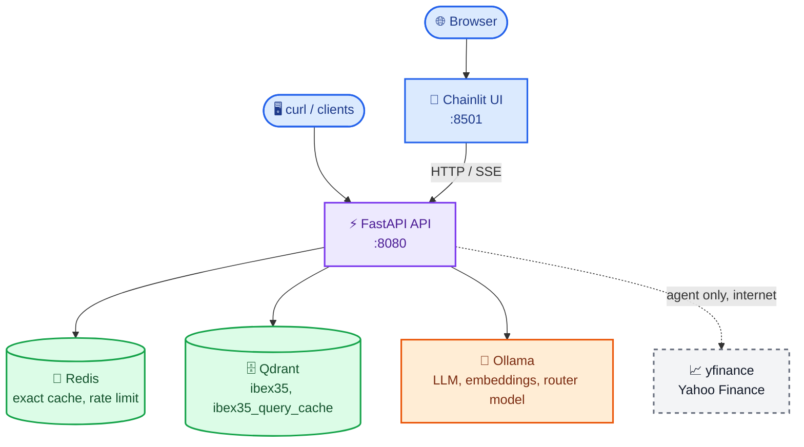
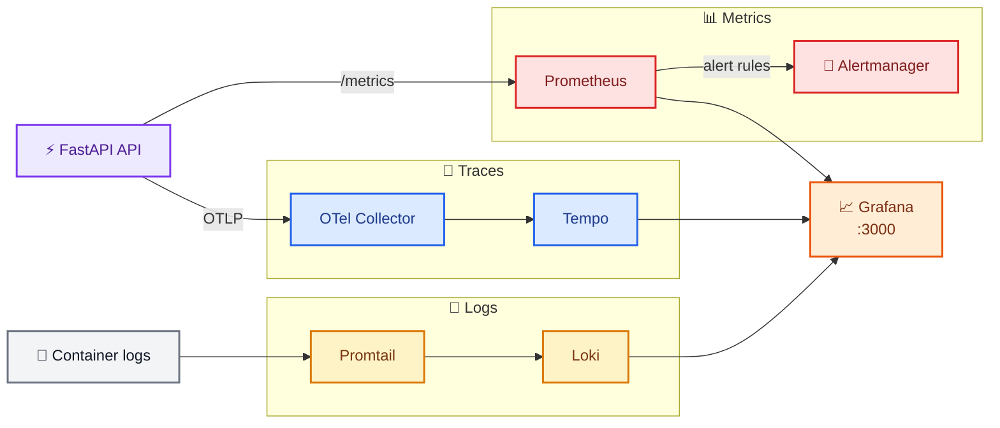
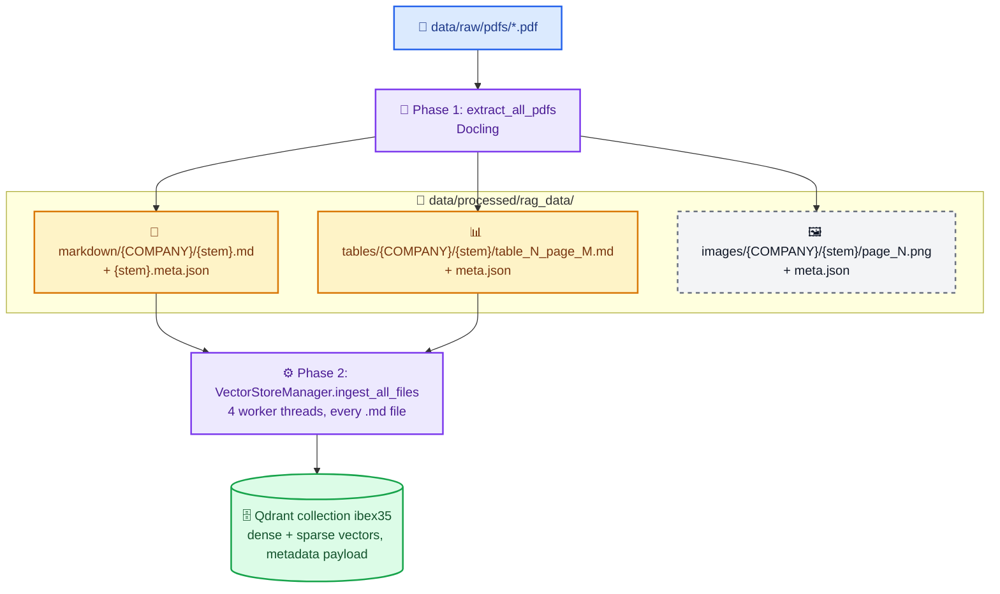

# Architecture

This document describes the components of IBEX35 RAG, how they are deployed, and how a request flows through them.

## Contents

- [Overview](#overview)
- [Components](#components)
- [Docker Compose services](#docker-compose-services)
- [Request lifecycle](#request-lifecycle)
- [Ingestion lifecycle](#ingestion-lifecycle)
- [Application layout](#application-layout)
- [Design decisions](#design-decisions)
- [Known limitations](#known-limitations)

## Overview



Observability runs alongside the application:



## Components

| Component | Code / config | Responsibility |
|---|---|---|
| API | `src/api/` | HTTP endpoints, validation, caching, rate limiting, routing between RAG and agent, metrics and tracing middleware. |
| RAG engine | `src/rag/engine.py` | Hybrid search, reranking, coverage gate, generation, online evaluation. |
| Retrieval helpers | `src/rag/retrieval.py` | Regex-based intent extraction (companies, period), out-of-domain detection, context reordering. |
| Vector store | `src/rag/vector_store/store.py` | Qdrant hybrid store (LangChain `QdrantVectorStore`), chunking, per-chunk period annotation, deduplication. |
| Ingestion | `src/ingestion/` | Docling PDF extraction, metadata extraction, pipeline orchestration, CLIs. |
| Agent | `src/agents/` | LangGraph tool-calling agent with session memory; market data tools over `yfinance`. |
| Semantic cache | `src/api/semantic_cache.py` | Separate Qdrant collection keyed by FastEmbed (`BAAI/bge-small-en-v1.5`) question vectors. |
| Observability | `src/observability/`, `infra/` | Prometheus metrics, LangSmith collector, and the configuration for the monitoring services. |
| Frontend | `frontend/app.py` | Chainlit chat client for the API. |

All long-lived objects (vector store client, RAG engine, agent, semantic cache, Redis pool) are process-wide singletons created lazily in `src/api/dependencies.py`.

## Docker Compose services

| Service | Image | Port(s) | Purpose |
|---|---|---|---|
| `api` | built from `infra/docker/backend.Dockerfile` | 8080 | FastAPI app. Mounts `./data` and `./src` (read-only). Reserves one GPU. |
| `ollama` | `ollama/ollama` | 11434 | Serves the LLM, embedding and router models. Reserves one GPU. |
| `qdrant` | `qdrant/qdrant` | 6333, 6334 | Vector store (collections `ibex35` and `ibex35_query_cache`). |
| `redis` | `redis:7-alpine` | 6379 | Exact-match cache and rate limiting. AOF persistence, 512 MB, `allkeys-lru`. |
| `frontend` | built from `frontend/Dockerfile` | 8501 | Chainlit chat UI. |
| `prometheus` | `prom/prometheus` | 9090 | Scrapes the API and exporters, evaluates alert rules. |
| `grafana` | `grafana/grafana` | 3000 | Dashboards; datasources and dashboards are provisioned from `infra/grafana/`. |
| `otel-collector` | `otel/opentelemetry-collector-contrib` | 4317, 4318, 8888 | Receives OTLP traces from the API and forwards them to Tempo. |
| `tempo` | `grafana/tempo` | 3200 | Trace storage. |
| `loki` | `grafana/loki` | 3100 | Log storage. |
| `promtail` | `grafana/promtail` | — | Ships Docker container logs to Loki. |
| `node-exporter` | `prom/node-exporter` | 9100 (host network) | Host metrics. |
| `cadvisor` | `gcr.io/cadvisor/cadvisor` | 8081 | Container metrics. |
| `redis-exporter` | `oliver006/redis_exporter` | 9121 | Redis metrics. |
| `redis-commander` | `rediscommander/redis-commander` | 8082 | Web UI for Redis. |
| `alertmanager` | `prom/alertmanager` | 9093 | Alert routing (null receiver by default). |

Named volumes persist Ollama models, Qdrant data, Redis, Prometheus, Grafana, Tempo, Loki and Alertmanager state across restarts. `make stop` keeps them; `docker compose down -v` deletes them.

The API image is built in two stages with `uv`. The BM25 sparse model and the cross-encoder reranker are downloaded at build time, after which Hugging Face is switched to offline mode.

## Request lifecycle

Example: `POST /api/v1/ask` with a fundamentals question.

1. **Middleware**: OpenTelemetry starts a span; the logging middleware binds `path`, `method`, `client_ip` and `trace_id` to every log line of the request.
2. **Rate limit**: a Redis sorted set per client IP implements a sliding window (`RATE_LIMIT_REQUESTS` per `RATE_LIMIT_WINDOW_SECONDS`). If Redis is down the request is let through.
3. **Routing**: `_should_use_agent` decides between RAG and the agent:
   - market keywords (price, quote, real time, ticker, ...) → agent;
   - both market and fundamental keywords → agent;
   - only fundamental keywords (EBITDA, revenue, debt, dividend, a year, ...) → RAG;
   - neither → one-word classification by the router model (`OLLAMA_ROUTER_MODEL`), defaulting to RAG on error.
4. **Caches** (RAG route only): exact-match Redis key `ibex35:query:<sha256(question|filter)>`, then a semantic lookup in Qdrant with similarity ≥ `SEMANTIC_CACHE_THRESHOLD` (0.92). A semantic hit is written back to the exact cache.
5. **RAG engine**: runs in a worker thread with the OpenTelemetry context propagated. See [rag-pipeline.md](rag-pipeline.md) for the stages.
6. **Response**: the answer is stored in both caches with `CACHE_TTL_SECONDS` and returned with sources and latency.

The agent route instead runs `FinancialAgent.run`, which lets the LLM call the RAG engine (as the `ibex35_financial_reports` tool) and the market tools, up to 8 model calls per request. Agent responses are not cached.

## Ingestion lifecycle



Page images are saved for inspection only; phase 2 indexes Markdown and table files, not PNGs.

Details in [rag-pipeline.md](rag-pipeline.md#ingestion).

## Application layout

```text
src/
  api/
    main.py            app factory, OTel setup, middleware, Prometheus, background metric refresh
    dependencies.py    lazy singletons (vector store, RAG engine, agent, semantic cache, Redis)
    routers/
      query.py         /query, /agent, /ask, /ask/stream and the routing heuristics
      ingest.py        /ingest (guarded by an asyncio lock)
      health.py        /health, /health/live, /health/ready
    schemas.py         Pydantic request/response models
    cache.py           exact-match Redis cache
    semantic_cache.py  Qdrant semantic cache
    rate_limiter.py    sliding-window rate limiter
  agents/
    financial_agent.py LangGraph agent, streaming and non-streaming runs
    agent_tools.py     yfinance tools
  core/
    config.py          Settings (pydantic-settings)
    logging.py         structlog JSON logging
  ingestion/
    fetch_reports.py   downloads and verifies the latest reports (make fetch)
    report_sources.csv one row per company: latest report URL, period, aliases
    metadata.py        company → ticker map, page-break marker, filename/content metadata
    pdf_loader.py      Docling conversion, tables, images (imports Docling)
    pipeline.py        two-phase IngestionPipeline
    preprocessor.py    CLI for phase 1 (make extract)
    run_ingestion.py   CLI for the full pipeline (make ingest)
  observability/
    metrics.py         all Prometheus metric definitions
    langsmith_collector.py  LangSmith → Prometheus background task
  rag/
    engine.py          RAGEngine
    retrieval.py       intent extraction and helpers
    prompts.py         RAG system prompt
    evaluation.py      proxy metrics and background RAGAS evaluation
    vector_store/store.py  VectorStoreManager
```

## Design decisions

- **Local-first**: LLM, embeddings, reranker and BM25 all run locally, so the knowledge base never leaves the machine and there is no per-token cost.
- **Regex intent extraction instead of an LLM call**: company, year and quarter detection is deterministic, fast and testable. The company list is closed (IBEX35), which makes regex practical.
- **Retrieve per company, then guarantee coverage**: in comparisons, one company with more or denser documents would otherwise take most of the context. Parallel per-company search and the per-company reranking floor prevent that.
- **Abstain before generating**: an LLM given context about only one of two companies tends to invent the other. The coverage gate answers deterministically in those cases, which is cheaper and more reliable than relying on the prompt alone.
- **Two caches**: exact matches are nearly free; the semantic cache catches paraphrases without an Ollama embedding call (FastEmbed runs in-process).
- **Synchronous engine, async API**: LangChain, the reranker and Docling are synchronous. The API offloads them to threads and propagates the OpenTelemetry context manually so traces stay connected.

## Known limitations

- The agent's conversation memory (`MemorySaver`) is in-process: it is lost on restart and not shared between workers. The API runs with a single Uvicorn worker.
- The streaming endpoint (`/ask/stream`) on the RAG route skips the caches, the out-of-domain check and the coverage gate; only the non-streaming endpoints enforce them.
- Abstention messages produced by the coverage gate are in Spanish regardless of the question language.
- Ingestion through `POST /api/v1/ingest` runs synchronously inside the request; for many PDFs prefer `make ingest`.
- CORS allows no browser origins by default (`CORS_ALLOW_ORIGINS`); the Chainlit frontend calls the API server-side and does not need it.
- There is no authentication; do not expose the stack publicly as is.
